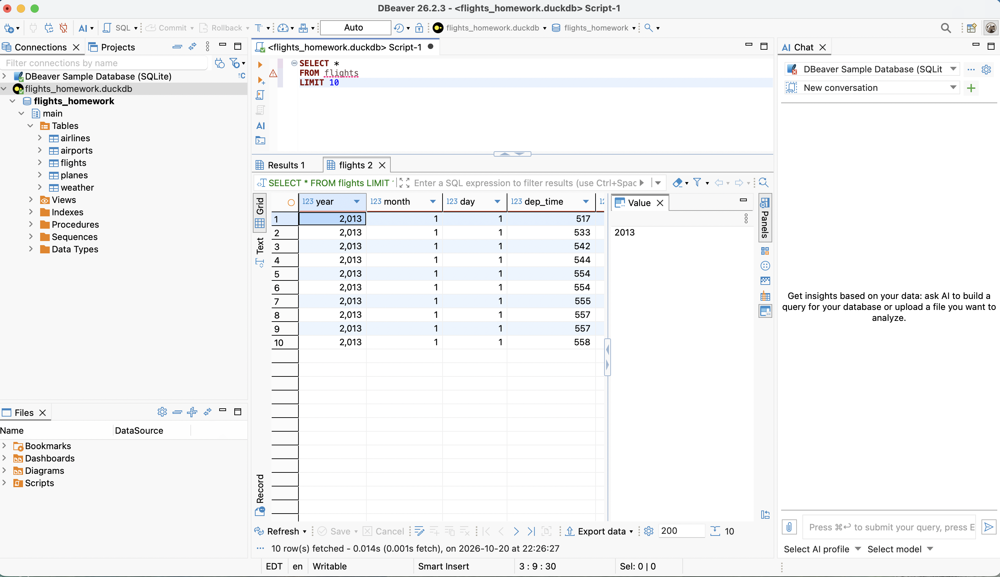
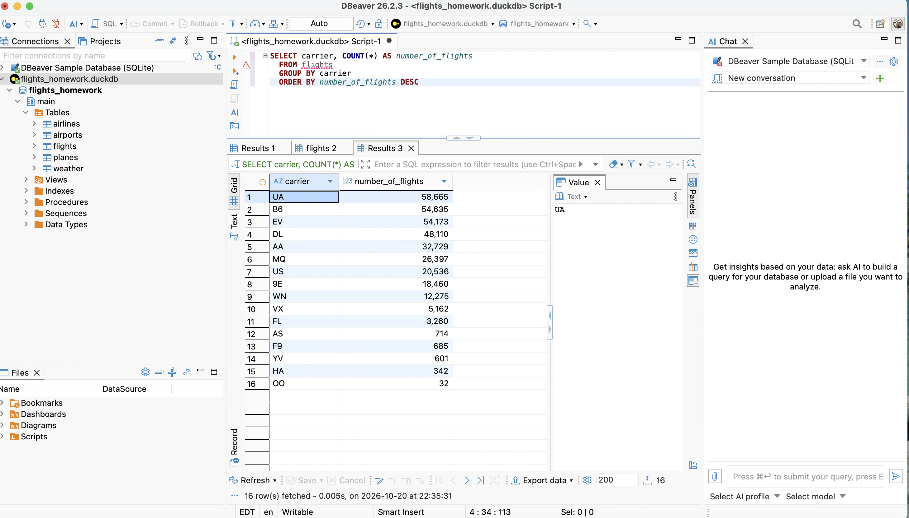

```{r setup, include=FALSE}
knitr::opts_chunk$set(echo       = TRUE, 
                      fig.align  = "center",
                      fig.height = 3, fig.width = 4)
ggplot2::theme_set(ggplot2::theme_bw() + ggplot2::theme(strip.background = ggplot2::element_rect(fill = "white")))
```

## Instructions

Complete the following exercises using the appropriate packages in R. Ensure that your solutions are optimized and use functional programming principles where applicable.

1.  Load the necessary libraries.
2.  Answer each question in separate R code chunks.
3.  Provide detailed explanations for your approach.
4.  **Instructions for Submitting the DBeaver Part of the Assignment**

- **Part I: Quarto / R Markdown Submission**

  1.  For each section of Part I, **enter your answer in a separate code chunk**.
  2.  Make sure your code runs correctly and produces the expected output.

- **Part II: DBeaver Screenshots**

  1.  For each section of Part II, **take a screenshot of your query results in DBeaver** code and output must be visible.

  2.  Insert the screenshots into the **appropriate sections of your Quarto/R Markdown document**.

> - Place each screenshot **directly after the corresponding answer section**.

3.  After uploading all screenshots, **render the document** (HTML or PDF) **before submission**.

- **Important: Verification**

  - **Double-check that all images display correctly** in the rendered document **before and after submission**.

  - If any screenshot does not appear properly, you **must fix it and re-render** the document before the due date.

  - Only documents with all visible images will be graded for Part II. \## SQL

- Load Packages `DBI`, `duckdb`, `nycflights13` and anything else you need

- Download the duck database. <https://data-science-master.github.io/lectures/data/flights.duckdb>

### Part I: Answer the following question by running SQL using **RStudio**.

```{r}
library(DBI)
library(duckdb)

db_path <- "/Users/zeynepyilmaz/Desktop/flights_homework.duckdb"

drv <- duckdb::duckdb(
  dbdir = db_path,
  read_only = TRUE
)

conn <- DBI::dbConnect(drv)

dbListTables(conn)
```

#### a This selects all columns (*) from flights and returns only the first 10 rows. 
```{r}
dbGetQuery(conn, "
  SELECT *
  FROM flights
  LIMIT 10
")
```


#### b.

Find the **number of flights**, counting all of the carriers and nameing it as number of flights.

```{r}
dbGetQuery(conn, "
  SELECT carrier, COUNT(*) AS number_of_flights
  FROM flights
  GROUP BY carrier
  ORDER BY number_of_flights DESC
")
```


#### c.

Find the **average departure delay** (`dep_delay`) Selecting the average of the departure delays and naming it as average_departure delay from flights.

```{r}
dbGetQuery(conn, "
  SELECT AVG(dep_delay) AS average_departure_delay
  FROM flights
")
```

#### d.

Find the **top 5 destinations** (`dest`) With the most flights.

- Your output should include:
  - destination
  - number of flights Sort from the **largest to smallest**.

selecting destinationsa and recording the number of these flights as number_of_flights.
  
```{r}
dbGetQuery(conn, "
  SELECT dest, COUNT(*) AS number_of_flights
  FROM flights
  GROUP BY dest
  ORDER BY number_of_flights DESC
  LIMIT 5
")


```


#### e.

Create a table showing:

- `carrier`

- average arrival delay (`arr_delay`)

Sort the results from **largest to smallest delay** 
Creating a table for 2 with carrier and average delay from flights grouping the delay by carriers and ordering the delay by descending.

```{r}
dbGetQuery(conn, "
  SELECT carrier, AVG(arr_delay) AS average_arrival_delay
  FROM flights
  GROUP BY carrier
  ORDER BY average_arrival_delay DESC
")

```

```{r}
dbDisconnect(conn)
```


> You must close the connection when you are done. Use `dbDisconnect()`

### Part II: Answer the following question by running SQL using **DBeaver** with **DuckDB**.

> Please go over the note **dbeaver_sql.html** to learn

#### a.

List the first **10 rows** of the `flights` table.




#### b.

Count the Number of Flights for Each Carrier

Find the **number of flights** for each carrier.

- Your output should include:
  - carrier
  - number of flights Sort from the **largest to smallest**.




#### c.

Find the **average departure delayby month**

- Your output should include:
  - month
  - average departure delay

#### d.

Find the **top 10 routes** (`dest`) by:

- `origin`

- `dest`

ordered by **number of flights**.

#### e.

Export the result of part b query to a **CSV file** using the **Export Data** feature in DBeaver.

Submit the exported CSV file along with your homework.

- **Exporting Data to CSV in DBeaver**

::: callout-note
### Quick Steps

1.  **Right-click** Table or Result Grid -\> **Export Data**.
2.  Select **CSV** -\> Click **Next**.
3.  Confirm **Settings** (Delimiters, Encoding) -\> Click **Next**.
4.  Choose **Output Directory** -\> Click **Finish**.
:::

## Remember to Close the connection When You Are Done

- **How to Disconnect and Reconnect a Database in DBeaver**

1.  On the **top menu**, click **Database**.

2.  From the drop-down menu, select **Disconnect**.

3.  You should see a message on the **bottom right corner**:

    ```         
    Not connected to database
    ```

4.  To reconnect, go to **Database → Connect** and select your connection.

> This is the easiest way to manage connections without closing DBeaver or losing work.

## Submission

- Save your Quarto file after completing each problem, render it, then stage and commit the changes.\

- Include well-commented code and clear explanations.\

- Make appropriate **commits**.\

- Submit the rendered file to **Canvas** and push it to your **GitHub repository**.\

**Good luck!**
